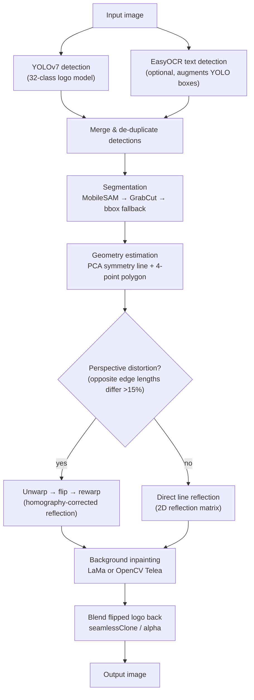
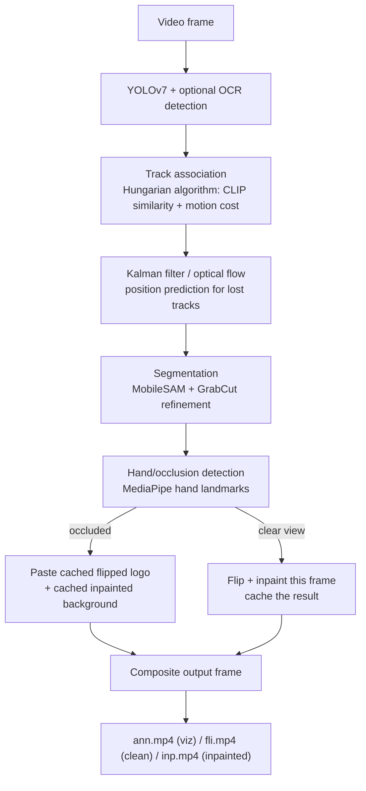
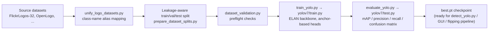
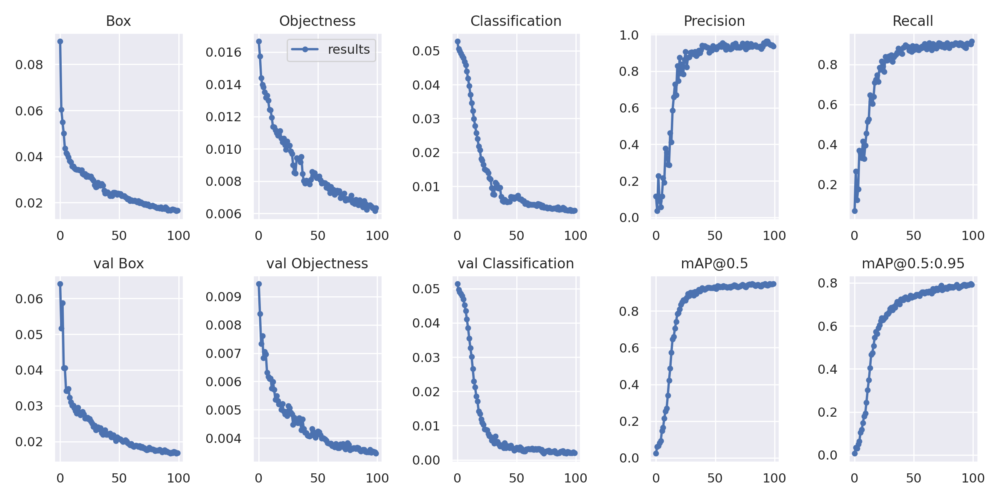
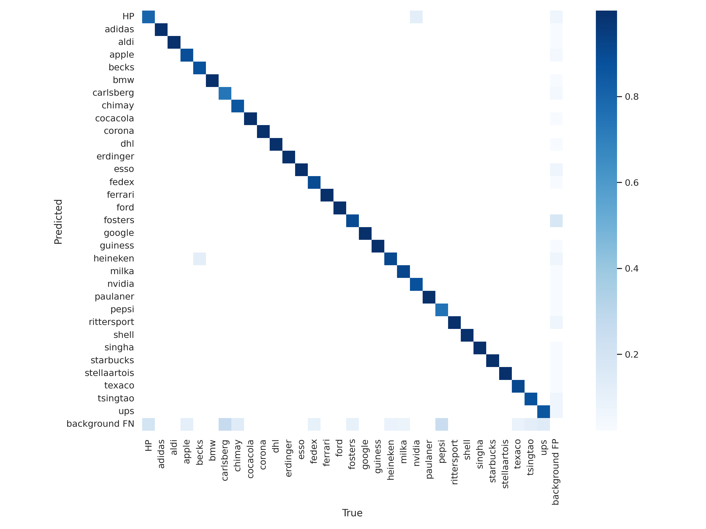
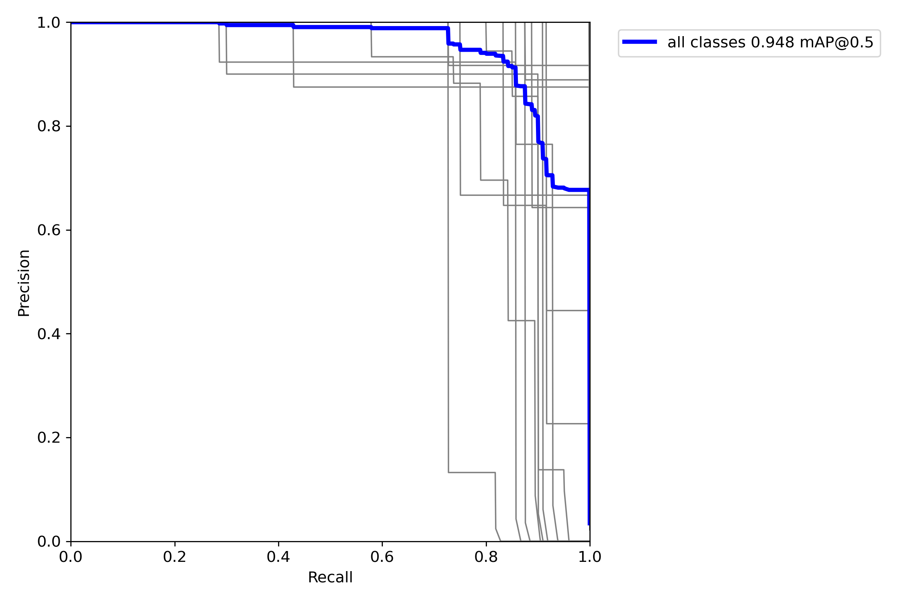
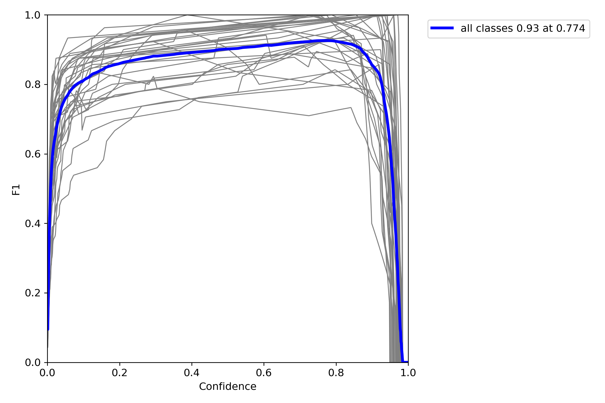
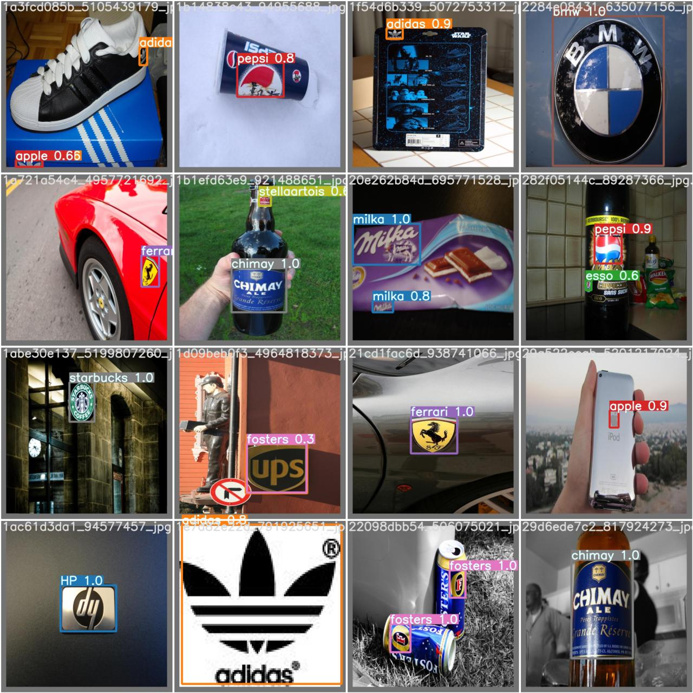
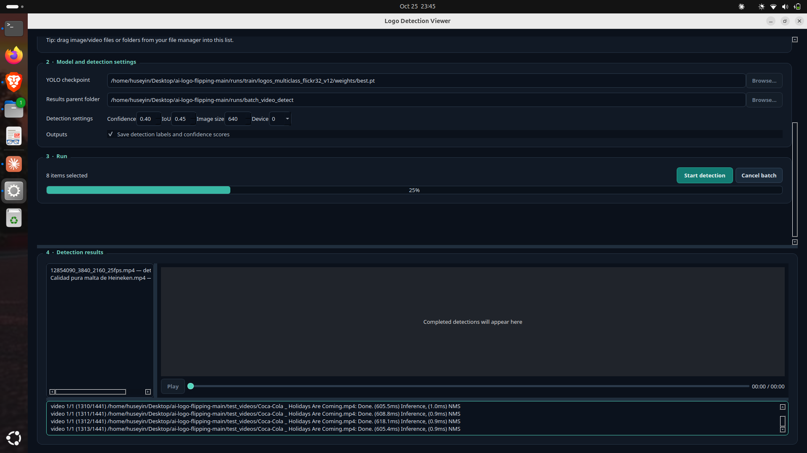

# Neural-Bridge-Internship-Logo-Detection — AI Logo Flipping

A complete Computer Vision pipeline for **detecting, tracking, segmenting, correcting, and reconstructing reflected or mirrored brand logos** in images and video. It combines a custom-trained YOLOv7 object detector, optional OCR, image segmentation (GrabCut / MobileSAM), perspective-aware geometric flipping, background inpainting, and multi-object video tracking into one pipeline — plus a desktop GUI for running it without the command line.

---

## Table of contents

- [System pipeline](#system-pipeline)
- [Repository structure](#repository-structure)
- [Setup](#setup)
- [Dataset](#dataset)
- [1. Training the model](#1-training-the-model)
- [2. Evaluating the model](#2-evaluating-the-model)
- [3. Running detection on images and videos](#3-running-detection-on-images-and-videos)
- [4. Desktop GUI](#4-desktop-gui)
- [5. The logo flipping pipeline](#5-the-logo-flipping-pipeline)
- [6. Video tracking and flipping](#6-video-tracking-and-flipping)

---

## System pipeline

### Single-image flipping pipeline



### Video tracking & flipping pipeline



### Training pipeline (YOLOv7)



---

## Repository structure

```
.
├── config.py                    # Shared project configuration
├── quick_start.sh               # One-shot environment sanity check
├── test_setup.py                # Verifies CUDA / dependency availability
├── assets/                      # Static images used in docs
├── docs/                        # README images: GUI screenshot, evaluation charts
│
├── yolov7/                      # Vendored YOLOv7 (WongKinYiu), patched for this project
│   ├── train.py, test.py, detect.py   # Core training / evaluation / inference scripts
│   ├── models/                        # yolo.py (architecture), common.py, experimental.py
│   ├── utils/                         # datasets.py, general.py, loss.py, metrics.py, ...
│   ├── cfg/training/yolov7.yaml       # Model architecture definition
│   └── data/hyp.scratch.p5*.yaml      # Hyperparameter presets (incl. a NaN-safe variant)
│
├── scripts/                     # This project's own tooling — the actual pipeline code
│   ├── train_yolo.py                  # Training wrapper: validates data, calls yolov7/train.py
│   ├── evaluate_yolo.py               # Evaluation wrapper: calls yolov7/test.py, builds reports
│   ├── detect_yolo.py                 # Inference wrapper: calls yolov7/detect.py
│   ├── dataset_validation.py          # Preflight dataset integrity checks
│   ├── unify_logo_datasets.py         # Merges multiple logo datasets into one taxonomy
│   ├── prepare_dataset_splits.py      # Leakage-aware train/val/test splitting
│   ├── convert_*.py                   # VOC / COCO / FlickrLogos32 → YOLO format converters
│   ├── audit_dataset.py               # Class balance + duplicate-image auditing
│   │
│   ├── logo_flipping_pipeline.py      # Single-image pipeline: detect→segment→flip→inpaint→blend
│   ├── video_logo_tracking.py         # Video pipeline: adds tracking, Kalman filter, occlusion handling
│   ├── sam_masker.py                  # MobileSAM wrapper used by both pipelines above
│   ├── clip_embedder.py               # CLIP embeddings for brand re-identification / tracking
│   ├── detect_unknown_logos.py        # Open-set brand matching (YOLO + CLIP gallery)
│   │
│   ├── video_detection_gui.py         # PyQt5 desktop GUI (see below)
│   └── README.md                      # Full CLI reference for every script above
│
├── datasets/                    # NOT included — see "Dataset" section below
├── runs/                        # NOT included — created locally by training/detection
├── reports/                     # NOT included — created locally by evaluate_yolo.py
├── test_images/, test_videos/   # NOT included — create these yourself, see below
```

**How the pieces relate:** `scripts/` is the project-specific layer; `yolov7/` is the underlying detector framework it drives. Training and evaluation never call `yolov7/train.py` / `yolov7/test.py` directly — they go through `scripts/train_yolo.py` / `scripts/evaluate_yolo.py`, which add dataset validation, path normalization, and reporting on top. The flipping pipeline (`logo_flipping_pipeline.py`) is the single-image core; `video_logo_tracking.py` builds on it frame-by-frame and adds everything temporal (tracking, Kalman prediction, occlusion caching). `video_detection_gui.py` is a thin PyQt front end over `detect_yolo.py` / `yolov7/detect.py` for batch image/video detection without the terminal.

---

## Setup

```bash
git clone https://github.com/huseyinTozluyurt/Neural-Bridge-Internship-Logo-Detection.git
cd Neural-Bridge-Internship-Logo-Detection

python3 -m venv .venv
source .venv/bin/activate

pip install -r yolov7/requirements.txt
pip install ultralytics mediapipe easyocr git+https://github.com/openai/CLIP.git
pip install -r scripts/requirements-gui.txt   # optional, only needed for the desktop GUI
pip install simple-lama-inpainting            # optional, better inpainting quality than OpenCV Telea
```

Download the pretrained YOLOv7 base weights (used as the starting point for training):
```bash
wget https://github.com/WongKinYiu/yolov7/releases/download/v0.1/yolov7.pt -P yolov7/
```

---

## Dataset

Datasets are **not included** in this repository (too large for git). This project was trained on **FlickrLogos-32** (32 brand classes), downloadable via Roboflow. `scripts/download_dataset.py` can fetch it automatically if you set a Roboflow API key:

```bash
export ROBOFLOW_API_KEY='your_key'
python scripts/download_dataset.py
```

Once downloaded in YOLO format, validate it before training:
```bash
python scripts/audit_dataset.py --data datasets/<your_dataset>/data.yaml --output reports/dataset_audit
```

`scripts/README.md` documents the full dataset pipeline in detail, including how to unify multiple logo datasets (`unify_logo_datasets.py`) into one combined class taxonomy if you want to train on more than FlickrLogos-32.

---

## 1. Training the model

Train a 32-class YOLOv7 logo detector:

```bash
python scripts/train_yolo.py \
    --data datasets/logos_yolo_multiclass_ready/data.yaml \
    --expect-classes 32 \
    --min-val-objects-per-class 5 \
    --weights yolov7/yolov7.pt \
    --hyp yolov7/data/hyp.scratch.p5.no_ota.yaml \
    --epochs 100 --img-size 416 --batch-size 4 --workers 0 --device 0 \
    --name logos_multiclass_flickr32_v1
```

Notes:
- `--hyp yolov7/data/hyp.scratch.p5.no_ota.yaml` uses a variant of YOLOv7's default hyperparameters with `loss_ota` disabled. The default OTA (Optimal Transport Assignment) loss is numerically unstable at very small batch sizes (needed on low-VRAM GPUs) and can produce `NaN` losses; this variant trains cleanly.
- Adjust `--batch-size` / `--img-size` to your GPU's VRAM. This project trained successfully on a 4GB GTX 1650 at `batch-size=4, img-size=416`.
- `--expect-classes` and `--min-val-objects-per-class` are safety guards — training aborts rather than silently proceeding if the dataset doesn't match expectations.

**Resuming an interrupted run** — always resume from `best.pt`, not `last.pt`. `best.pt` is only ever overwritten when validation fitness genuinely improves, so it can never be corrupted by a bad epoch, while `last.pt` is overwritten unconditionally every epoch:
```bash
python scripts/train_yolo.py \
    --data datasets/logos_yolo_multiclass_ready/data.yaml \
    --expect-classes 32 --min-val-objects-per-class 5 \
    --weights yolov7/yolov7.pt --hyp yolov7/data/hyp.scratch.p5.no_ota.yaml \
    --epochs 100 --img-size 416 --batch-size 4 --workers 0 --device 0 \
    --name logos_multiclass_flickr32_v1 \
    --resume runs/train/logos_multiclass_flickr32_v1/weights/best.pt
```

### Training curves (this project's actual run, 100 epochs)

<p align="center">

</p>

---

## 2. Evaluating the model

```bash
python scripts/evaluate_yolo.py \
    --data datasets/logos_yolo_multiclass_ready/data.yaml \
    --weights runs/train/logos_multiclass_flickr32_v1/weights/best.pt \
    --img-size 416 \
    --device 0
```

**Important:** always pass `--img-size` matching your training resolution — it defaults to 640. On some GPUs, FP16 inference in `yolov7/test.py` can silently produce invalid results; if evaluation metrics come back as zero despite a model that trains and detects fine elsewhere, add `--no-half` to `scripts/evaluate_yolo.py`'s underlying `test.py` call (already wired through both scripts) to force FP32 inference.

This writes a full report to `reports/checkpoint_evaluation/<run>/`: `evaluation_report.json`, `confusion_matrix.png`, PR/F1 curves, per-class metrics CSV, false-positive and missed-detection CSVs with annotated examples.

### Results on the held-out test split (32-class FlickrLogos-32 model, 224 test images)

| Metric | Value |
|---|---|
| mAP@0.5 | **94.75%** |
| mAP@0.5:0.95 | **82.04%** |
| Precision | 85.71% |
| Recall | 92.88% |
| F1 | 89.15% |
| True positives / False positives / Missed | 300 / 50 / 23 (of 323 ground-truth logos) |

<p align="center">

<br><em>Confusion matrix</em>
</p>

<p align="center">


</p>

<p align="center">

<br><em>Predicted boxes on held-out test images</em>
</p>

<details>
<summary>Full per-class breakdown (click to expand)</summary>

| Class | GT | TP | FP | FN | Precision | Recall | AP@0.5 | AP@0.5:0.95 |
|---|---|---|---|---|---|---|---|---|
| HP | 11 | 8 | 3 | 3 | 0.73 | 0.73 | 0.737 | 0.617 |
| adidas | 8 | 8 | 1 | 0 | 0.89 | 1.00 | 0.982 | 0.867 |
| aldi | 14 | 14 | 1 | 0 | 0.93 | 1.00 | 0.995 | 0.849 |
| apple | 9 | 8 | 2 | 1 | 0.80 | 0.89 | 0.956 | 0.602 |
| becks | 7 | 7 | 1 | 0 | 0.88 | 1.00 | 0.995 | 0.979 |
| bmw | 7 | 7 | 1 | 0 | 0.88 | 1.00 | 0.995 | 0.870 |
| carlsberg | 19 | 14 | 2 | 5 | 0.88 | 0.74 | 0.832 | 0.519 |
| chimay | 14 | 12 | 0 | 2 | 1.00 | 0.86 | 0.909 | 0.732 |
| cocacola | 9 | 9 | 1 | 0 | 0.90 | 1.00 | 0.995 | 0.846 |
| corona | 7 | 7 | 0 | 0 | 1.00 | 1.00 | 0.995 | 0.995 |
| dhl | 11 | 11 | 1 | 0 | 0.92 | 1.00 | 0.973 | 0.605 |
| erdinger | 13 | 13 | 0 | 0 | 1.00 | 1.00 | 0.995 | 0.854 |
| esso | 7 | 7 | 3 | 0 | 0.70 | 1.00 | 0.995 | 0.864 |
| fedex | 10 | 9 | 1 | 1 | 0.90 | 0.90 | 0.836 | 0.774 |
| ferrari | 7 | 7 | 0 | 0 | 1.00 | 1.00 | 0.995 | 0.878 |
| ford | 8 | 8 | 0 | 0 | 1.00 | 1.00 | 0.995 | 0.907 |
| fosters | 20 | 18 | 8 | 2 | 0.69 | 0.90 | 0.893 | 0.807 |
| google | 7 | 7 | 0 | 0 | 1.00 | 1.00 | 0.995 | 0.914 |
| guiness | 7 | 7 | 1 | 0 | 0.88 | 1.00 | 0.924 | 0.888 |
| heineken | 12 | 10 | 3 | 2 | 0.77 | 0.83 | 0.923 | 0.822 |
| milka | 12 | 11 | 2 | 1 | 0.85 | 0.92 | 0.933 | 0.697 |
| nvidia | 7 | 7 | 2 | 0 | 0.78 | 1.00 | 0.995 | 0.897 |
| paulaner | 9 | 9 | 1 | 0 | 0.90 | 1.00 | 0.995 | 0.882 |
| pepsi | 8 | 6 | 2 | 2 | 0.75 | 0.75 | 0.912 | 0.682 |
| rittersport | 18 | 18 | 3 | 0 | 0.86 | 1.00 | 0.995 | 0.888 |
| shell | 7 | 7 | 0 | 0 | 1.00 | 1.00 | 0.995 | 0.906 |
| singha | 7 | 7 | 1 | 0 | 0.88 | 1.00 | 0.995 | 0.927 |
| starbucks | 8 | 8 | 1 | 0 | 0.89 | 1.00 | 0.995 | 0.980 |
| stellaartois | 7 | 7 | 1 | 0 | 0.88 | 1.00 | 0.995 | 0.925 |
| texaco | 11 | 10 | 1 | 1 | 0.91 | 0.91 | 0.906 | 0.839 |
| tsingtao | 8 | 7 | 4 | 1 | 0.64 | 0.88 | 0.875 | 0.740 |
| ups | 14 | 12 | 3 | 2 | 0.80 | 0.86 | 0.811 | 0.701 |

Full machine-readable results: [`docs/eval_per_class_metrics.csv`](docs/eval_per_class_metrics.csv).
</details>

---

## 3. Running detection on images and videos

`test_images/` and `test_videos/` are not committed to this repository. Create them yourself and drop in your own sample media:

```bash
mkdir -p test_images test_videos
# then copy your own .jpg/.png images into test_images/
# and your own .mp4/.mov videos into test_videos/
```

Run detection on a folder of images:
```bash
python scripts/detect_yolo.py \
    --weights runs/train/logos_multiclass_flickr32_v1/weights/best.pt \
    --source test_images/ \
    --img-size 416 \
    --conf 0.4
```

Run detection on a folder of videos:
```bash
python scripts/detect_yolo.py \
    --weights runs/train/logos_multiclass_flickr32_v1/weights/best.pt \
    --source test_videos/ \
    --img-size 416 \
    --conf 0.4
```

Annotated output is written to `runs/detect/<name>/`, with YOLO-format label files alongside if `--save-txt` behavior is left at its default (see `scripts/README.md` for the full flag reference).

---

## 4. Desktop GUI

`scripts/video_detection_gui.py` is a PyQt5 desktop app that wraps the same detection pipeline for batch image/video processing without the terminal — pick a checkpoint, select files or whole folders (including drag-and-drop), tune confidence/IoU/image size, and watch per-item progress with inline logs.

```bash
pip install -r scripts/requirements-gui.txt
python scripts/video_detection_gui.py
```

<p align="center">

</p>

The GUI lets you browse to a `.pt` checkpoint and a results folder, set detection parameters, queue multiple images/videos, and review completed detections (annotated image preview / video playback) in the same window once a batch finishes.

---

## 5. The logo flipping pipeline

Detects a logo, segments it, determines whether it's reflected, and flips + inpaints it back into the image — correcting for perspective if the logo sits on an angled or curved surface:

```bash
python scripts/logo_flipping_pipeline.py \
    --yolo-weights runs/train/logos_multiclass_flickr32_v1/weights/best.pt \
    --input path/to/reflected_logo.jpg \
    --output path/to/output.jpg \
    --artifact-dir path/to/artifacts \
    --naturalise-mode auto \
    --blend-mode seamless \
    --use-easyocr \
    --save-intermediates
```

---

## 6. Video tracking and flipping

Tracks logos across frames (Kalman filter + optical flow + CLIP re-identification), handles hand occlusion, and produces both an annotated visualization and a clean corrected output video:

```bash
python scripts/video_logo_tracking.py \
    --input path/to/video.mp4 \
    --output-viz path/to/annotated.mp4 \
    --output-clean path/to/flipped.mp4 \
    --yolo-weights runs/train/logos_multiclass_flickr32_v1/weights/best.pt \
    --yolo-conf 0.5 \
    --use-sam-masker \
    --use-fine-grid-tracking
```

See `scripts/README.md` for the complete flag reference for every script in this project, including dataset conversion/unification tools, checkpoint evaluation options, and advanced tracking/occlusion parameters.
